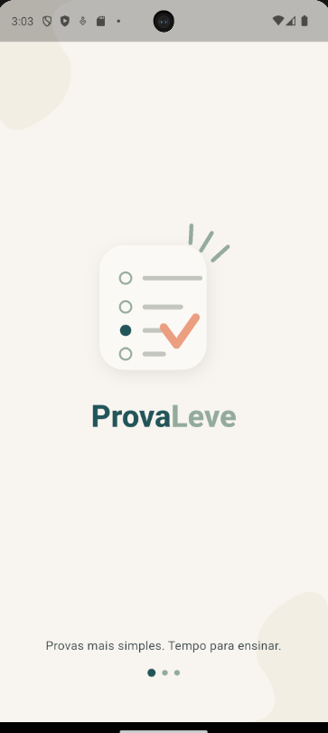
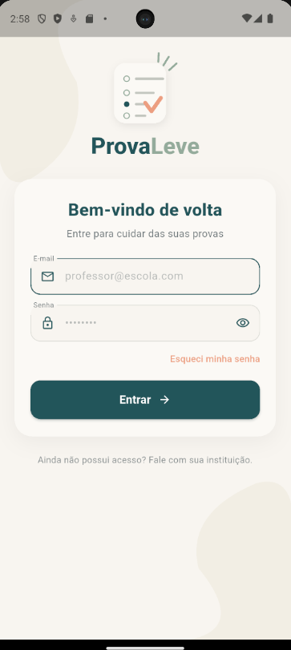
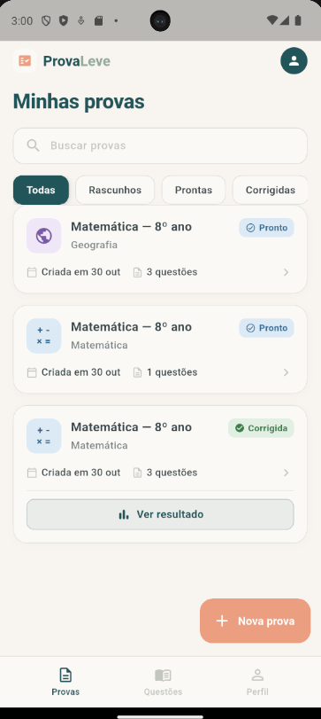
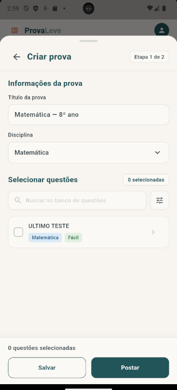
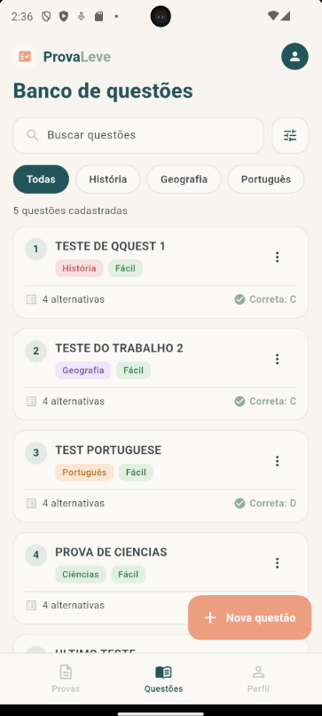
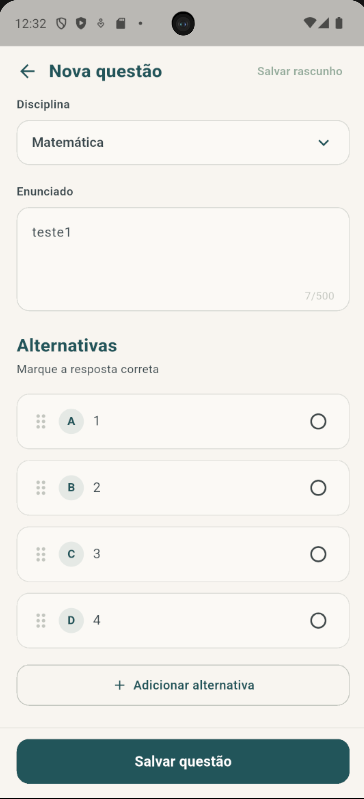
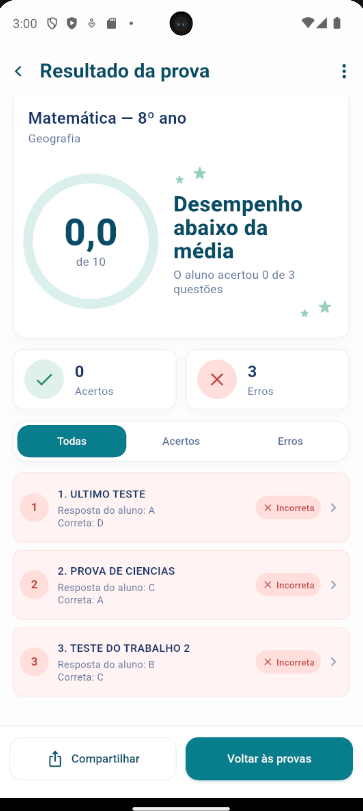
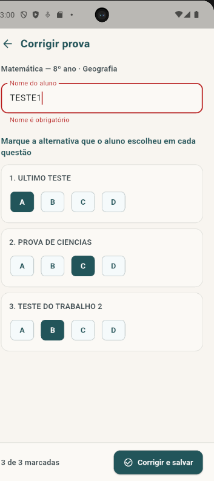
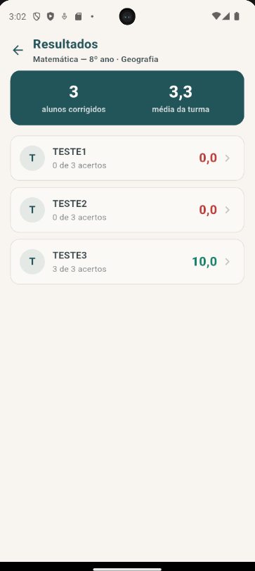

# PROVALEVE

Provas mais simples. Tempo para ensinar.

<div align="center">


</div>

---

## Equipe

| Integrante                        |
| --------------------------------- |
| Cauã Cozzarin                     |
| Mateus Wroblewski                 |
| Mário Augusto Bussarello Volpato  |
| Felipe Tomio Maciel               |
| Matheus Henrique Pompeu           |

---

## Sumário

* [Equipe](#equipe)
* [1. Resumo do Projeto](#1-resumo-do-projeto)
* [2. Objetivo](#2-objetivo)
* [3. Escopo Delimitado](#3-escopo-delimitado)
  * [3.1 Funcionalidades dentro do escopo](#31-funcionalidades-dentro-do-escopo)
  * [3.2 Funcionalidades previstas para evolução](#32-funcionalidades-previstas-para-evolução)
  * [3.3 Fora do escopo inicial](#33-fora-do-escopo-inicial)
* [4. Requisitos Funcionais — RF](#4-requisitos-funcionais--rf)
* [5. Requisitos Não Funcionais — RNF](#5-requisitos-não-funcionais--rnf)
* [6. Telas Principais](#6-telas-principais)
  * [6.1 Abertura](#61-abertura)
  * [6.2 Login](#62-login)
  * [6.3 Minhas Provas](#63-minhas-provas)
  * [6.4 Criar Prova](#64-criar-prova)
  * [6.5 Banco de Questões](#65-banco-de-questões)
  * [6.6 Nova Questão](#66-nova-questão)
  * [6.7 Resultado da Prova](#67-resultado-da-prova)
  * [6.8 Correção da Prova](#68-correção-da-prova)
  * [6.9 Lista de Resultados](#69-lista-de-resultados)
* [7. Fluxo Principal do Sistema](#7-fluxo-principal-do-sistema)
* [8. Público-Alvo](#8-público-alvo)
* [9. Interface e Experiência de Uso](#9-interface-e-experiência-de-uso)
* [10. Status do Projeto](#10-status-do-projeto)
  * [10.1 Estado da integração com o banco de dados](#101-estado-da-integração-com-o-banco-de-dados)
  * [10.2 Configuração do Firebase no aplicativo](#102-configuração-do-firebase-no-aplicativo)
* [11. Como Rodar o Projeto](#11-como-rodar-o-projeto)
* [12. Stack Tecnológica](#12-stack-tecnológica)
* [13. Estrutura de Pastas](#13-estrutura-de-pastas)
* [14. Modelo de Dados](#14-modelo-de-dados)
* [15. Backlog de Atividades da N2](#15-backlog-de-atividades-da-n2)

---

## 1. Resumo do Projeto

O ProvaLeve é um aplicativo desenvolvido para auxiliar professores no processo de criação, organização e correção de provas.

O projeto surgiu a partir da necessidade de reduzir o tempo gasto pelos professores com a correção de avaliações. Durante períodos de provas, um professor pode ter um grande volume de avaliações para corrigir, tornando esse processo demorado.

A proposta do ProvaLeve é centralizar o processo de avaliação em uma aplicação, permitindo o gerenciamento de questões e provas, além da apresentação dos resultados após a correção.

O sistema também busca facilitar a análise do desempenho dos alunos, apresentando informações como acertos, erros, resposta marcada e alternativa correta.

---

## 2. Objetivo

O objetivo principal do ProvaLeve é simplificar e automatizar o processo de avaliação, reduzindo o trabalho manual realizado pelos professores.

O sistema tem como objetivos:

* Facilitar a criação de provas;
* Permitir o gerenciamento de um banco de questões;
* Reutilizar questões cadastradas;
* Automatizar a correção das provas;
* Apresentar os resultados de forma rápida;
* Facilitar a visualização de acertos e erros;
* Permitir a análise das respostas dos alunos.

A correção automatizada foi identificada pelo cliente como a funcionalidade mais importante do sistema.

---

## 3. Escopo Delimitado

### 3.1 Funcionalidades dentro do escopo

As funcionalidades dentro do escopo do projeto são:

* Abertura do aplicativo;
* Login do professor;
* Gerenciamento das provas;
* Criação de provas;
* Banco de questões;
* Cadastro de novas questões;
* Definição do gabarito;
* Correção automatizada;
* Visualização dos resultados;
* Visualização de acertos e erros;
* Visualização das respostas marcadas;
* Consulta detalhada das questões corrigidas.

Essas funcionalidades foram definidas nos wireframes do aplicativo e implementadas no app Flutter.

### 3.2 Funcionalidades previstas para evolução

Foram levantadas também algumas funcionalidades adicionais que podem ser incorporadas posteriormente:

* Importação da lista de alunos;
* Geração de provas individualizadas por aluno;
* Geração de relatório de notas;
* Exportação dos resultados para Excel;
* Edição do layout da prova gerada.

Essas funcionalidades foram apresentadas pelo cliente como sugestões adicionais ao projeto.

### 3.3 Fora do escopo inicial

Não fazem parte do escopo inicial:

* Cadastro livre de professores pelo aplicativo;
* Gerenciamento acadêmico completo da instituição;
* Criação de conteúdo educacional;
* Correção de questões discursivas;
* Funcionalidades que não estejam relacionadas ao processo de criação, aplicação e correção de provas.

---

## 4. Requisitos Funcionais — RF

| Código   | Requisito | Situação |
| -------- | --------- | -------- |
| **RF01** | O sistema deve permitir que o professor realize login utilizando e-mail e senha. | Atendido (usuários de teste locais; autenticação pelo Firebase não implementada) |
| **RF02** | O sistema deve permitir a recuperação de senha. | Parcial |
| **RF03** | O sistema deve permitir visualizar as provas do professor. | Atendido (Firestore) |
| **RF04** | O sistema deve permitir pesquisar provas. | Atendido (Firestore) |
| **RF05** | O sistema deve permitir filtrar provas por situação. | Atendido (Firestore) |
| **RF06** | O sistema deve permitir criar uma nova prova. | Atendido (Firestore) |
| **RF07** | O sistema deve permitir selecionar questões para compor uma prova. | Atendido (Firestore) |
| **RF08** | O sistema deve permitir pesquisar questões no banco de questões. | Atendido (Firestore) |
| **RF09** | O sistema deve permitir cadastrar novas questões. | Atendido (Firestore) |
| **RF10** | O sistema deve permitir cadastrar alternativas para uma questão. | Atendido (Firestore) |
| **RF11** | O sistema deve permitir definir a alternativa correta de uma questão. | Atendido (Firestore) |
| **RF12** | O sistema deve permitir editar questões cadastradas. | Atendido (Firestore) |
| **RF13** | O sistema deve permitir duplicar questões. | Atendido (Firestore) |
| **RF14** | O sistema deve permitir excluir questões. | Atendido (Firestore) |
| **RF15** | O sistema deve permitir salvar uma questão como rascunho. | Atendido (Firestore) |
| **RF16** | O sistema deve realizar a correção automatizada das provas. | Atendido (correção feita no aplicativo a partir das respostas marcadas pelo professor; a leitura por QR Code ainda não existe) |
| **RF17** | O sistema deve permitir que o professor visualize a nota obtida pelo aluno. | Atendido (Firestore) |
| **RF18** | O sistema deve permitir que o professor visualize a quantidade de acertos e erros do aluno. | Atendido (Firestore) |
| **RF19** | O sistema deve permitir que o professor visualize a resposta marcada pelo aluno. | Atendido (Firestore) |
| **RF20** | O sistema deve permitir que o professor visualize a alternativa correta nas questões em que o aluno errou. | Atendido (Firestore) |
| **RF21** | O sistema deve permitir que o professor visualize a correção detalhada da prova do aluno. | Atendido (Firestore) |
| **RF22** | O sistema deve permitir compartilhar ou exportar o resultado. | Atendido (compartilhamento com share_plus) |

Os requisitos foram definidos a partir das funcionalidades descritas nos wireframes e das necessidades apresentadas pelo cliente. A coluna Situação mostra o que já está implementado no aplicativo.

Legenda da situação:

* **Atendido (Firestore):** a funcionalidade está implementada e grava ou lê os dados no Firestore. As provas (RF03 a RF06) usam o `ProvasRepository` e as questões (RF07 e RF08 a RF15) usam o `QuestoesRepository`;
* **Atendido (compartilhamento com share_plus):** o resultado é compartilhado pelo menu de compartilhamento do celular;
* **Atendido (usuários de teste locais):** o login funciona com os usuários de teste do aplicativo, sem autenticação pelo Firebase;
* **Parcial:** existe apenas a interface, sem a lógica completa;
* **Não atendido:** ainda não foi implementado.

Observação: a correção automatizada (RF16) é feita pelo professor. Na tela de correção, ele informa o nome do aluno e marca a alternativa escolhida em cada questão; o aplicativo calcula acertos, erros e nota, grava o resultado na coleção `resultados` e muda a prova para "corrigida". Ainda falta a leitura do QR Code e do gabarito da prova do aluno, que dispensaria a marcação manual das respostas. A tela de resultado (RF17 a RF21) é voltada ao professor, e não ao aluno.

Observação sobre o Firestore e os dados locais: o banco de questões lista, cria, edita, duplica e exclui as questões no Firestore (RF08 a RF15), e a lista é carregada do banco sempre que a tela é aberta. A tela de criar prova (RF07) lista as questões publicadas do banco (sem os rascunhos) para o professor escolher. Os resultados (RF17 a RF21) vêm do Firestore: ao tocar em "Ver resultado" ou "Visualizar Resultados" em uma prova corrigida, o aplicativo lista os resultados gravados na coleção `resultados` (`listarPorProva`), com a média da turma e a nota e os acertos de cada aluno, e a tela de resultado mostra o nome do aluno, as respostas marcadas e a correção detalhada. Recuperar senha (RF02) mostra apenas um aviso orientando o professor a falar com a instituição.

---

## 5. Requisitos Não Funcionais — RNF

| Código    | Requisito                                                                                    | Situação |
| --------- | -------------------------------------------------------------------------------------------- | -------- |
| **RNF01** | A interface deve ser simples e fácil de utilizar.                                            | Atendido (telas minimalistas, seguindo os wireframes) |
| **RNF02** | A navegação deve ser lógica e objetiva.                                                      | Atendido (rotas nomeadas, seguindo o fluxo da seção 7) |
| **RNF03** | As informações devem ser apresentadas de forma clara e organizada.                           | Atendido |
| **RNF04** | O sistema deve proteger as informações de acesso do professor.                               | Parcial (a senha fica oculta na tela e não é gravada no Firestore; o login ainda usa usuários de teste locais, sem Firebase Authentication) |
| **RNF05** | O resultado da correção deve ser apresentado de forma rápida.                                | Atendido (a nota é calculada no próprio aplicativo, em `lib/utils/correcao.dart`, sem depender de rede) |
| **RNF06** | A interface deve evitar excesso de elementos visuais.                                        | Atendido |
| **RNF07** | Os acertos e erros devem possuir identificação visual clara.                                 | Atendido (cores e ícones de certo e errado na tela de resultado) |
| **RNF08** | Cada professor deve ter acesso somente às suas próprias provas e questões.                   | Atendido (o `professorId` é gravado em cada documento e as consultas são filtradas por ele em `lib/data/firestore_repository.dart`; como o login ainda não usa o Firebase Authentication, as regras de segurança do Firestore só poderão garantir isso depois da autenticação) |
| **RNF09** | O sistema deve apresentar mensagens de erro quando ocorrerem problemas durante uma operação. | Atendido (mensagens de erro em `lib/utils/mensagem_erro.dart`, estados de carregando, vazio e erro em `lib/widgets/estado_tela.dart` e avisos nas telas) |
| **RNF10** | O aplicativo deve possuir uma interface adequada para dispositivos móveis.                   | Atendido (aplicativo Flutter com layout para celular) |

A preferência do cliente é por uma interface minimalista, lógica, amigável e com poucos elementos na tela.

---

## 6. Telas Principais

O ProvaLeve possui 9 telas principais, definidas nos wireframes e já implementadas em Flutter.

### 6.1 Abertura

É a primeira tela apresentada ao iniciar o aplicativo.



*Figura 6.1 — Tela de abertura com a identidade visual do ProvaLeve.*

Função:

* Apresentar a identidade visual do ProvaLeve;
* Exibir o nome e slogan;
* Apresentar o carregamento inicial;
* Encaminhar o usuário para o login.

---

### 6.2 Login

Tela responsável pela autenticação do professor.



*Figura 6.2 — Tela de login com e-mail e senha.*

Elementos principais:

* Campo de e-mail;
* Campo de senha;
* Exibição/ocultação da senha;
* Recuperação de senha;
* Botão "Entrar".

---

### 6.3 Minhas Provas

Tela principal apresentada após o login.



*Figura 6.3 — Lista de provas do professor, com busca e filtros por situação.*

Elementos principais:

* Perfil do professor;
* Lista de provas;
* Busca;
* Filtros;
* Status das provas;
* Acesso aos resultados;
* Botão para criar uma nova prova.

---

### 6.4 Criar Prova

Tela utilizada para montar uma nova prova utilizando questões cadastradas.



*Figura 6.4 — Montagem de uma prova com a seleção das questões.*

Elementos principais:

* Título da prova;
* Disciplina;
* Busca de questões;
* Filtros;
* Seleção das questões;
* Contador de questões selecionadas;
* Visualização dos detalhes das questões.

---

### 6.5 Banco de Questões

Tela responsável por centralizar as questões cadastradas.



*Figura 6.5 — Banco de questões com busca, filtros e ações sobre cada questão.*

Elementos principais:

* Quantidade de questões cadastradas;
* Busca;
* Filtros;
* Organização por disciplina;
* Nível de dificuldade;
* Editar questão;
* Duplicar questão;
* Excluir questão;
* Criar nova questão.

---

### 6.6 Nova Questão

Tela destinada ao cadastro de uma nova questão de múltipla escolha.



*Figura 6.6 — Cadastro de uma questão de múltipla escolha com definição do gabarito.*

Elementos principais:

* Disciplina;
* Enunciado;
* Alternativas;
* Reordenação das alternativas;
* Definição do gabarito;
* Adição de alternativas;
* Salvar como rascunho;
* Salvar questão.

---

### 6.7 Resultado da Prova

Tela voltada ao professor, responsável pela apresentação do resultado de um aluno após a correção da prova. O aluno não acessa o aplicativo: é o professor quem visualiza a nota, o desempenho e as respostas do aluno.



*Figura 6.7 — Resultado de um aluno com nota, acertos, erros e correção detalhada.*

Elementos principais:

* Nota;
* Percentual de desempenho;
* Quantidade de acertos;
* Quantidade de erros;
* Filtro entre acertos e erros;
* Resposta marcada;
* Alternativa correta;
* Correção detalhada;
* Compartilhamento do resultado.

---

### 6.8 Correção da Prova

Tela em que o professor corrige a prova de um aluno. Ela é aberta pelos detalhes de uma prova já postada ("Corrigir prova") e também pode ser usada de novo para corrigir a prova de outro aluno. O professor informa o nome do aluno e marca a alternativa que o aluno escolheu em cada questão. O aplicativo calcula os acertos, os erros e a nota, grava o resultado na coleção `resultados` do Firestore e muda a prova para "corrigida". Em seguida, abre a tela de resultado.



*Figura 6.8 — Correção de uma prova com o nome do aluno e as respostas marcadas pelo professor.*

Elementos principais:

* Título e disciplina da prova;
* Campo com o nome do aluno (obrigatório);
* Lista das questões, com as alternativas para marcar a resposta do aluno;
* Contador de questões marcadas;
* Aviso de questões em branco, que contam como erro;
* Botão "Corrigir e salvar".

---

### 6.9 Lista de Resultados

Tela aberta por "Visualizar Resultados" (ou "Ver resultado") em uma prova corrigida na tela Minhas Provas. Ela lê do Firestore os resultados gravados na correção daquela prova e mostra o desempenho da turma. Ao tocar em um aluno, o professor abre a tela de resultado (6.7) com o nome, a nota e a correção detalhada.



*Figura 6.9 — Lista dos alunos corrigidos de uma prova, com a média da turma, a nota e os acertos de cada um.*

Elementos principais:

* Título e disciplina da prova;
* Quantidade de alunos corrigidos;
* Média da turma;
* Lista de alunos, em ordem alfabética, com a nota e os acertos de cada um;
* Estados de carregando, erro (com "Tentar novamente") e "Nenhum aluno corrigido".

---

## 7. Fluxo Principal do Sistema


ABERTURA
   ↓
LOGIN
   ↓
MINHAS PROVAS
   ↓
┌─────────────────────┐
│                     │
↓                     ↓
CRIAR PROVA      BANCO DE QUESTÕES
│                     │
↓                     ↓
SELECIONAR        NOVA QUESTÃO
QUESTÕES              │
│                     ↓
└──────────────→ BANCO DE QUESTÕES
          ↓
      CRIAR PROVA
          ↓
       CORREÇÃO
          ↓
   RESULTADO DA PROVA

---

## 8. Público-Alvo

O ProvaLeve é destinado principalmente a professores que trabalham com avaliações e possuem um grande volume de provas para corrigir.

O sistema busca reduzir o tempo utilizado na correção e facilitar a análise dos resultados obtidos pelos alunos.

---

## 9. Interface e Experiência de Uso

A interface do ProvaLeve foi projetada para ser simples, amigável e objetiva.

A proposta considera uma navegação lógica e uma quantidade reduzida de elementos na tela, seguindo a preferência apresentada pelo cliente por uma experiência mais minimalista.

Os wireframes validaram o fluxo de utilização do aplicativo, e as telas implementadas em Flutter seguem esse fluxo.

---

## 10. Status do Projeto

Status: Em desenvolvimento 🚧

Entrega atual: N2.

O aplicativo já possui código Flutter funcional para as telas de abertura, login, perfil, minhas provas, criar prova, banco de questões, nova questão e resultado da prova. Nesta etapa as principais telas já leem e gravam no Firestore:

* **Minhas Provas:** lista, pesquisa e filtra as provas gravadas no Firestore, cria novas provas e atualiza rascunhos e provas postadas;
* **Banco de Questões e Nova Questão:** a tela lista as questões do Firestore ao abrir e permite criar, editar, duplicar e excluir questões (inclusive rascunhos) direto no Firestore;
* **Criar Prova:** a seleção de questões lê as questões publicadas do Firestore (sem rascunhos), com busca e filtro por dificuldade, e tem estados de carregando, erro e vazio (RF07);
* **Camada de acesso a dados:** `ProvasRepository`, `QuestoesRepository` e `ResultadosRepository`, em `lib/data/`, gravam o `professorId` e filtram as consultas por ele (RNF08);
* **Tratamento de erros:** mensagens de erro, estados de carregando, lista vazia e erro, e avisos nas telas (RNF09);
* **Correção da prova:** o professor informa o nome do aluno e marca as respostas; o aplicativo calcula acertos, erros e nota, grava o resultado na coleção `resultados` e muda a prova para "corrigida" (RF16);
* **Lista de resultados:** "Visualizar Resultados" em Minhas Provas lista os resultados reais da prova lidos do Firestore, com a média da turma e a nota e os acertos de cada aluno (RF17 a RF21);
* **Resultado da prova:** mostra o nome do aluno, a nota, os acertos e erros e a correção detalhada, e pode ser compartilhado pelo menu de compartilhamento do celular (RF22).

O que ainda é local ou de exemplo:

* O login usa usuários de teste que ficam no próprio aplicativo (`lib/screens/login/mock_usuario.dart`). O Firebase Authentication não foi implementado e a coleção `usuarios` ainda não é lida nem gravada;
* As respostas de cada aluno são marcadas manualmente pelo professor na tela de correção, pois a leitura por QR Code ainda não existe;
* O filtro por professor (RNF08) é feito pelo aplicativo. As regras de segurança do Firestore só poderão garantir isso quando houver autenticação.

Ainda não foram implementados:

* Leitura do QR Code e do gabarito da prova do aluno (hoje o professor marca as respostas manualmente na correção);
* Autenticação pelo Firebase (RF01 e RNF04, parciais);
* Fluxo completo de recuperação de senha (RF02, parcial).

Vídeo de apresentação: https://www.youtube.com/watch?v=Q-urOUDrMoM


### 10.1 Estado da integração com o banco de dados

O ProvaLeve usa o **Cloud Firestore** (Firebase) como banco de dados. A tabela mostra, para cada parte do aplicativo, se ela já lê e grava no Firestore ou se ainda usa dados locais.

| Parte do aplicativo | Operação | Estado | Onde está |
| ------------------- | -------- | ------ | --------- |
| Inicialização do Firebase | Conexão do aplicativo com o projeto Firebase | Integrada | `lib/main.dart` e `lib/firebase_options.dart` |
| Classes de domínio | Conversão de e para o Firestore (`toMap` e `fromMap`) | Integrada | `lib/models/` |
| Login | Entrar com e-mail e senha | Local (usuários de teste) | `lib/screens/login/mock_usuario.dart` |
| Recuperar senha | Aviso para falar com a instituição | Local | `lib/screens/login/` |
| Minhas Provas | Listar, pesquisar, filtrar, criar e atualizar provas | Integrada | `ProvasRepository` |
| Criar Prova | Listar as questões publicadas para seleção | Integrada | `QuestoesRepository` |
| Banco de Questões | Listar, editar, duplicar e excluir questões | Integrada | `QuestoesRepository` |
| Nova Questão | Criar questão e salvar como rascunho | Integrada | `QuestoesRepository` |
| Correção da Prova | Gravar o resultado do aluno e mudar a prova para "corrigida" | Integrada | `ResultadosRepository` e `ProvasRepository` |
| Lista de Resultados e Resultado da Prova | Ler os resultados gravados de uma prova | Integrada | `ResultadosRepository` |
| Perfil | Mostrar os dados do professor logado | Local (usuário de teste) | `lib/screens/perfil/` |

Legenda:

* **Integrada:** a parte lê ou grava os dados no Firestore, sem lista fixa no código;
* **Local:** a parte ainda usa dados que ficam dentro do aplicativo.

Validação e tratamento de erros nas operações com o banco:

* Os campos são validados antes de gravar. O login usa os validadores de `lib/utils/validators.dart` (e-mail e senha). O cadastro de questão exige a disciplina, o enunciado (mínimo de 10 caracteres), todas as alternativas preenchidas e sem repetição, e a alternativa correta marcada;
* Ao editar uma questão, "Salvar rascunho" também exige os dados completos, para não sobrescrever no banco uma questão válida com dados incompletos;
* Editar, duplicar e excluir mostram um aviso de sucesso ou de erro ao gravar, e excluir pede confirmação antes;
* As listas têm estados de carregando, vazio e erro (RNF09).

Os campos de cada coleção estão na seção [14. Modelo de Dados](#14-modelo-de-dados).

### 10.2 Configuração do Firebase no aplicativo

A conexão do aplicativo Android com o Firebase foi feita assim:

1. O projeto **ProvaLeve** (`provaleve-46c08`, plano Spark) foi criado no console do Firebase e o **Cloud Firestore** foi ativado;
2. As dependências `firebase_core` e `cloud_firestore` foram adicionadas ao `pubspec.yaml` (versões na seção [12. Stack Tecnológica](#12-stack-tecnológica));
3. O comando `flutterfire configure` (plataforma Android) gerou o arquivo `lib/firebase_options.dart` e o arquivo `android/app/google-services.json`;
4. No `lib/main.dart`, o Firebase é inicializado antes de abrir o aplicativo:

```dart
Future<void> main() async {
  WidgetsFlutterBinding.ensureInitialized();
  await Firebase.initializeApp(
    options: DefaultFirebaseOptions.currentPlatform,
  );
  runApp(const MyApp());
}
```

Observações:

* O `google-services.json` não fica no repositório. Para rodar o aplicativo, veja o passo 2 da seção [11. Como Rodar o Projeto](#11-como-rodar-o-projeto);
* O acesso ao console do Firebase é feito por permissão da conta. Para ver os dados no console, peça ao responsável pelo Firebase do grupo para adicionar o seu e-mail ao projeto;
* O filtro por professor (RNF08) é feito pelo aplicativo. As regras de segurança do Firestore só poderão garantir esse acesso quando o login passar a usar o Firebase Authentication.

---

## 11. Como Rodar o Projeto

### Pré-requisitos

* [Flutter SDK](https://docs.flutter.dev/get-started/install) com Dart ^3.13.2;
* Android Studio (ou VS Code) com o plugin do Flutter;
* Um emulador Android ou um celular com depuração USB ativada;
* Git.

Para conferir o ambiente:

```bash
flutter doctor
```

### Passo a passo

```bash
# 1. Clonar o repositório
git clone https://github.com/cauacozz11/app-mobile.git
cd app-mobile

# 2. Colocar o arquivo google-services.json em android/app/
#    (ele não vem no repositório; veja a observação abaixo)

# 3. Baixar as dependências
flutter pub get

# 4. Listar os dispositivos disponíveis
flutter devices

# 5. Executar o aplicativo
flutter run
```

### Observações

* **Passo 2, obrigatório:** para compilar o app, é necessário o arquivo `google-services.json` do projeto Firebase em `android/app/google-services.json`. Ele não fica no repositório (está no `.gitignore`); peça ao responsável pelo Firebase do grupo e copie o arquivo para essa pasta antes de rodar o `flutter run`.
* Para entrar no aplicativo, use um dos usuários de teste: `professor@escola.com` / `provaleve` ou `caua@provaleve.com` / `123456`.

---

## 12. Stack Tecnológica


* **Flutter:** framework usado para criar o aplicativo móvel (interface em Material Design);
* **Dart:** linguagem do aplicativo, com SDK `^3.13.2` (definido no `pubspec.yaml`);
* **Firebase:** plataforma do projeto, inicializada no app pelo `firebase_core` (`^5.1.0`);
* **Cloud Firestore:** banco de dados NoSQL do projeto, acessado pelo pacote `cloud_firestore` (`^7.1.0`);
* **share_plus:** pacote (`^13.3.1`) usado para compartilhar o resultado da prova pelo menu de compartilhamento do celular.

---

## 13. Estrutura de Pastas

```text
app-mobile/
├── docs/
│   ├── modelo_firestore.md
│   └── telas/
├── lib/
│   ├── data/
│   │   ├── firestore_repository.dart
│   │   ├── provas_repository.dart
│   │   ├── questoes_repository.dart
│   │   └── resultados_repository.dart
│   ├── models/
│   │   ├── alternativa.dart
│   │   ├── prova.dart
│   │   ├── questao.dart
│   │   ├── resultado.dart
│   │   ├── sessao.dart
│   │   └── usuario.dart
│   ├── screens/
│   │   ├── correcao/
│   │   ├── login/
│   │   ├── perfil/
│   │   ├── provas/
│   │   ├── questoes/
│   │   ├── resultados/
│   │   └── splash.dart
│   ├── utils/
│   │   ├── correcao.dart
│   │   ├── mensagem_erro.dart
│   │   └── validators.dart
│   ├── widgets/
│   │   └── estado_tela.dart
│   ├── firebase_options.dart
│   └── main.dart
├── test/
│   ├── correcao_test.dart
│   └── mensagem_erro_test.dart
└── pubspec.yaml
```

* **docs/:** documentação do projeto. `modelo_firestore.md` descreve as coleções do Firestore e `telas/` guarda os prints das telas usados neste README;
* **lib/data/:** camada de acesso ao Firestore. `FirestoreRepository` tem as operações comuns (listar, buscar, criar, atualizar e excluir, com `professorId`) e cada coleção tem o seu repositório;
* **lib/models/:** classes de domínio (`Usuario`, `Questao`, `Alternativa`, `Prova`, `Resultado`), com conversão de e para o Firestore (`toMap` e `fromMap`), e a `Sessao`, que guarda o professor logado;
* **lib/screens/:** as telas do aplicativo, uma subpasta para cada área:
  * **correcao/:** tela de correção da prova (`correcao_prova_screen.dart`);
  * **login/:** tela de login e os usuários de teste (`mock_usuario.dart`);
  * **perfil/:** tela de perfil do professor;
  * **provas/:** listagem de provas (Minhas Provas) e criação de prova (tela e janela de criação);
  * **questoes/:** banco de questões, cadastro de nova questão e a classe `QuestaoCadastrada`;
  * **resultados/:** lista de resultados de uma prova (`lista_resultados_screen.dart`) e tela de resultado de um aluno (`resultado_prova_screen.dart`);
  * **splash.dart:** tela de abertura;
* **lib/utils/:** funções de apoio: validação de campos (`validators.dart`) e a conta da correção (`correcao.dart`), além das mensagens de erro para o professor (`mensagem_erro.dart`);
* **lib/widgets/:** componentes reutilizáveis; `estado_tela.dart` traz os estados de carregando, lista vazia e erro;
* **test/:** testes automatizados: `correcao_test.dart` (conta da correção e leitura do resultado) e `mensagem_erro_test.dart` (mensagens de erro).

---

## 14. Modelo de Dados

O ProvaLeve guarda os dados em quatro coleções na raiz do Firestore. Em todas elas o id do documento é o mesmo `id` da classe de domínio.

| Coleção | O que guarda | Situação no app |
| ------- | ------------ | --------------- |
| `usuarios` | Dados do professor: nome, e-mail, instituição e disciplinas (a senha não é gravada). | Ainda não é lida nem gravada, pois o login usa usuários de teste. |
| `questoes` | Banco de questões do professor: disciplina, dificuldade, rascunho, enunciado, alternativas e alternativa correta. | Lida, gravada, editada e excluída pelo banco de questões. |
| `provas` | Provas montadas pelo professor: título, disciplina, situação, data e uma cópia das questões escolhidas. | Lida e gravada pela tela Minhas Provas. |
| `resultados` | Resultado da correção de um aluno: prova corrigida, nome do aluno, respostas marcadas e nota. | Gravada pela tela de correção (um documento por aluno corrigido, com o nome do aluno) e lida pela lista de resultados da prova. |

As coleções `questoes`, `provas` e `resultados` guardam o `professorId`, que liga cada documento ao professor dono dele e permite listar só os dados dele (RNF08). A prova guarda uma cópia das questões, então editar ou excluir uma questão do banco não altera uma prova já montada.

O diagrama, os campos de cada coleção e as decisões de modelagem estão em [docs/modelo_firestore.md](docs/modelo_firestore.md).

---

## 15. Backlog de Atividades da N2

O backlog segue o planejamento da N2 (`PlanejamentoN2.xlsx`). O status considera o que já foi mesclado na branch `main` por commit ou Pull Request.

### Cauã Cozzarin

| Tarefa | Prazo | Status |
| ------ | ----- | ------ |
| 1. Reunião de planejamento e divisão de tarefas | 02/10/2026 | Em andamento |
| 8. Tela 1: trocar dados mock por leitura do Firestore | 16/10/2026 | Em andamento |
| 12. Funcionalidade central do escopo do cliente (ponta a ponta): tela de correção da prova (PR #39) | 22/10/2026 | Concluído |
| 19. Zerar PRs pendentes e merge final | 27/10/2026 | Em andamento |
| 22. Diário de bordo individual – Cauã Cozzarin | 29/10/2026 | Em andamento |
| Extra: ajustes gerais (renomear `validators.dart` e remover o teste de conexão do `main.dart`, PR #37) | — | Concluído |
| Extra: Visualizar Resultados com a lista de resultados reais lidos do Firestore e remoção do `mock_resultado.dart` (PR #40) | — | Concluído |

### Mateus Wroblewski

| Tarefa | Prazo | Status |
| ------ | ----- | ------ |
| 2. Levantar pendências da N1 (itens "não atendido" do README) | 05/10/2026 | Concluído |
| 3. Ampliar e ajustar as Issues no repositório (Issues #23 a #31) | 06/10/2026 | Concluído |
| 9. Tela 2: trocar dados mock por gravação no Firestore (Nova Questão, PR #33) | 16/10/2026 | Concluído |
| 16. Ajustes pendentes da N1 (RNF e tela de resultado) | 23/10/2026 | Concluído |
| 20. README v2: escopo, telas e RF/RNF (PR #22 e esta atualização) | 28/10/2026 | Concluído |
| 23. Diário de bordo individual – Mateus Wroblewski | 29/10/2026 | Concluído |
| Extra: revisão dos PRs #21, #32 e #34 | — | Concluído |
| Extra: merge do PR #32 | — | Concluído |
| Extra: Banco de Questões carregando do Firestore, sem dados mock (PR #38) | — | Concluído |

### Mário Augusto Bussarello Volpato

| Tarefa | Prazo | Status |
| ------ | ----- | ------ |
| 4. Criar projeto Firebase, ativar Firestore e conectar o app | 06/10/2026 | Concluído |
| 10. Tela 3: edição e exclusão no Firestore | 19/10/2026 | Concluído |
| 14. Validação de formulários antes de gravar | 21/10/2026 | Concluído |
| 21. README v2: estado da integração com o banco | 28/10/2026 | Em andamento |
| 24. Diário de bordo individual – Mário Augusto Bussarello Volpato | 29/10/2026 | Em andamento |

### Felipe Tomio Maciel

| Tarefa | Prazo | Status |
| ------ | ----- | ------ |
| 5. Modelar coleções e documentos do Firestore | 06/10/2026 | Concluído |
| 7. Criar camada de acesso a dados (CRUD com Firestore) | 13/10/2026 | Concluído |
| 13. Tratamento de erros e telas vazias/carregando | 22/10/2026 | Concluído |
| 17. Testes do fluxo completo e dos RNF | 26/10/2026 | Em andamento |
| 25. Diário de bordo individual – Felipe Tomio Maciel | 29/10/2026 | Em andamento |

### Matheus Henrique Pompeu

| Tarefa | Prazo | Status |
| ------ | ----- | ------ |
| 6. Ampliar/ajustar classes de domínio | 09/10/2026 | Concluído |
| 11. Tela 4: consulta/filtros no Firestore | 19/10/2026 | Concluído |
| 15. Ajustes pendentes da N1 (telas/RF) | 23/10/2026 | Concluído |
| 18. Revisão e merge dos PRs (semanas 1 a 4) | 27/10/2026 | Em andamento |
| 26. Diário de bordo individual – Matheus Henrique Pompeu | 29/10/2026 | Em andamento |
