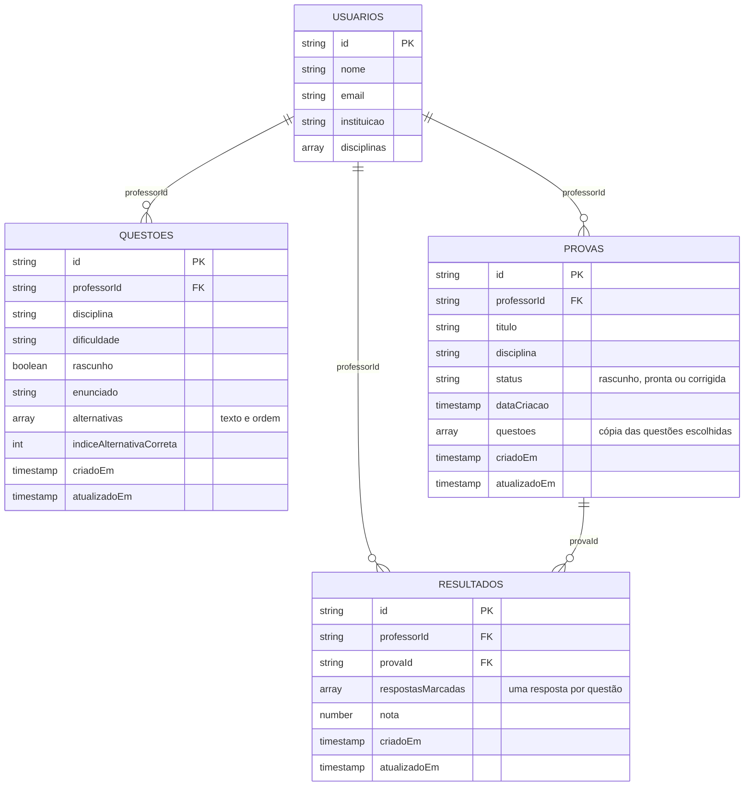

# Modelo de dados do Firestore

O ProvaLeve guarda os dados em quatro coleções na raiz do Firestore: `usuarios`, `questoes`, `provas` e `resultados`. Em todas elas o id do documento é o mesmo `id` da classe de domínio, então uma busca por id não precisa de consulta.

## Diagrama



## Coleções

### usuarios

Dados do professor (classe `Usuario`). A senha não é gravada no banco.

| Campo | Tipo | Descrição |
| --- | --- | --- |
| id | string | Id do professor |
| nome | string | Nome completo |
| email | string | E-mail de acesso |
| instituicao | string | Instituição onde leciona |
| disciplinas | array de string | Disciplinas do professor |

Como o login ainda usa os usuários de teste do app, essa coleção não é lida nem gravada por enquanto. O `id` dela é o mesmo valor gravado em `professorId` nas outras coleções.

### questoes

Banco de questões do professor (classe `QuestaoCadastrada`).

| Campo | Tipo | Descrição |
| --- | --- | --- |
| id | string | Id da questão |
| professorId | string | Professor dono da questão |
| disciplina | string | Matemática, Ciências, História, Geografia ou Português |
| dificuldade | string | Fácil, Média ou Difícil |
| rascunho | boolean | `true` quando foi salva como rascunho (RF15) |
| enunciado | string | Texto da questão |
| alternativas | array de map | Cada item tem `texto` (string) e `ordem` (int) |
| indiceAlternativaCorreta | int | Posição da alternativa correta (0 = A, 1 = B...) |
| criadoEm | timestamp | Data em que o documento foi criado com `criar` |
| atualizadoEm | timestamp | Data da última edição |

### provas

Provas montadas pelo professor (classe `Prova`).

| Campo | Tipo | Descrição |
| --- | --- | --- |
| id | string | Id da prova |
| professorId | string | Professor dono da prova |
| titulo | string | Título da prova |
| disciplina | string | Disciplina da prova |
| status | string | `rascunho`, `pronta` ou `corrigida`. Campo previsto: a classe `Prova` ainda não tem esse campo e a situação fica só na tela |
| dataCriacao | timestamp | Data de criação mostrada na listagem |
| questoes | array de map | Cópia das questões escolhidas: `id`, `enunciado`, `alternativas` e `indiceAlternativaCorreta` |
| criadoEm | timestamp | Data em que o documento foi criado com `criar` |
| atualizadoEm | timestamp | Data da última edição |

### resultados

Resultado da correção da prova de um aluno (classe `Resultado`).

| Campo | Tipo | Descrição |
| --- | --- | --- |
| id | string | Id do resultado |
| professorId | string | Professor que corrigiu |
| provaId | string | Prova corrigida |
| respostasMarcadas | array de int | Alternativa marcada em cada questão, na ordem da prova (-1 = em branco) |
| nota | number | Nota do aluno |
| criadoEm | timestamp | Data em que o documento foi criado com `criar` |
| atualizadoEm | timestamp | Data da última edição |

## Decisões

- **A prova guarda uma cópia das questões.** Editar ou excluir uma questão do banco não muda uma prova já montada nem a correção feita com ela.
- **O resultado aponta para a prova pelo `provaId`.** A correção compara `respostasMarcadas[i]` com `questoes[i].indiceAlternativaCorreta` da prova.
- **`professorId` em questões, provas e resultados (RNF08).** O app grava o id do professor logado e só lista os documentos dele. Como o login ainda não usa o Firebase Authentication, esse filtro é feito pelo app; as regras de segurança do Firestore só vão conseguir garantir isso quando houver autenticação.
- **Datas** são gravadas como `timestamp`. `criadoEm` e `atualizadoEm` usam a hora do servidor. Documentos que nasceram de uma edição (`atualizar` usa merge e cria o documento se ele não existir) só têm `atualizadoEm`.

## Acesso pelo app

As operações ficam em `lib/data/`. Todas as classes herdam de `FirestoreRepository`, que já grava o `professorId` e filtra as consultas por ele.

| Classe | Coleção | Métodos |
| --- | --- | --- |
| `QuestoesRepository.instance` | questoes | `listar`, `buscar`, `criar`, `atualizar`, `excluir` |
| `ProvasRepository.instance` | provas | `listar`, `buscar`, `criar`, `atualizar`, `excluir` |
| `ResultadosRepository.instance` | resultados | os mesmos, mais `listarPorProva` |

Sem internet:

- as leituras devolvem o que já está em cache no aparelho; se não houver nada, dão erro de conexão;
- as gravações e exclusões ficam salvas no aparelho e são enviadas quando a conexão voltar.

Para mostrar o erro ao professor, use `mensagemErro(erro)` (`lib/utils/mensagem_erro.dart`). Nas telas que listam dados, os estados de carregando, lista vazia e erro ficam em `EstadoTela` (`lib/widgets/estado_tela.dart`):

```dart
late Future<List<QuestaoCadastrada>> _carregamento =
    QuestoesRepository.instance.listar();

FutureBuilder<List<QuestaoCadastrada>>(
  future: _carregamento,
  builder: (context, snapshot) {
    if (snapshot.connectionState != ConnectionState.done) {
      return const EstadoTela.carregando();
    }
    if (snapshot.hasError) {
      return EstadoTela.erro(
        mensagem: mensagemErro(snapshot.error!),
        onTentarNovamente: () => setState(() {
          _carregamento = QuestoesRepository.instance.listar();
        }),
      );
    }
    final questoes = snapshot.data!;
    if (questoes.isEmpty) {
      return const EstadoTela.vazio(titulo: 'Nenhuma questão cadastrada');
    }
    return ListView(
      children: [for (final q in questoes) Text(q.questao.enunciado)],
    );
  },
)
```
