# Testes do fluxo completo e dos RNF

Responsável: Felipe Tomio Maciel
Data: 30/10/2026

Teste manual do app ligado ao Firestore real, seguindo o caminho de um professor: entrar, montar o banco de questões, criar e postar uma prova, corrigir a prova de um aluno e consultar o resultado. Também foram testados os requisitos não funcionais que dá para verificar no app (RNF04, RNF05, RNF07, RNF08, RNF09 e RNF10). Os prints de cada passo estão em [evidencias/](evidencias/).

## Ambiente

* Emulador Android Pixel 7 com Android 16 (API 36);
* Flutter 3.47.8, build de debug;
* Banco: Firestore do projeto `provaleve-46c08`;
* Usuários: `professor@escola.com` (Ana Carolina), `caua@provaleve.com` (Cauã Costa) e `mario@provaleve.com` (Mario Silva).

## Resumo

| Caso | O que foi testado | Requisitos | Resultado |
| --- | --- | --- | --- |
| CT01 | Login com campos vazios e com senha errada | RF01, RNF04, RNF09 | Passou |
| CT02 | Login válido e carregamento de Minhas Provas | RF01, RF03 | Passou |
| CT03 | Banco de questões lido do Firestore | RF08 | Passou |
| CT04 | Cadastro de questão: validação, gravação e busca | RF08 a RF11, RNF09 | Passou |
| CT05 | Criação e postagem de prova | RF06, RF07 | Passou |
| CT06 | Correção da prova e resultado do aluno | RF16 a RF21, RNF05, RNF07 | Passou |
| CT07 | Lista de resultados da prova e compartilhamento | RF22 | Passou |
| CT08 | Edição e exclusão de questão | RF12, RF14 | Passou |
| CT09 | Cada professor vê só os próprios dados | RNF08 | Passou |
| CT10 | Uso sem internet e volta da conexão | RNF09 | Passou |
| CT11 | Dados vindos do servidor depois de limpar o app | RNF09 | Passou, com observação |

Todos os casos rodaram no emulador de celular, o que cobre o RNF10.

## Casos de teste

### CT01 – Login inválido

Passos: tocar em "Entrar" com os campos vazios; depois informar `professor@escola.com` com uma senha errada.

Esperado: o app não entra e explica o problema.

Obtido: com os campos vazios aparecem "E-mail é obrigatório" e "Informe a senha". Com a senha errada aparece "E-mail ou senha inválidos". A senha fica oculta enquanto é digitada (RNF04).

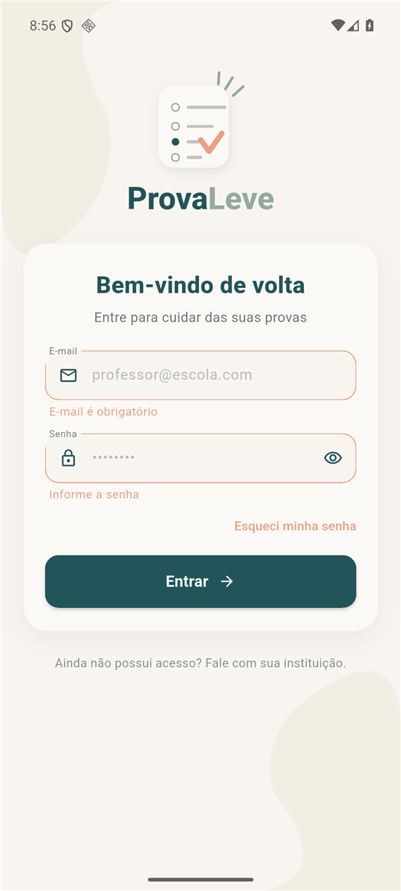 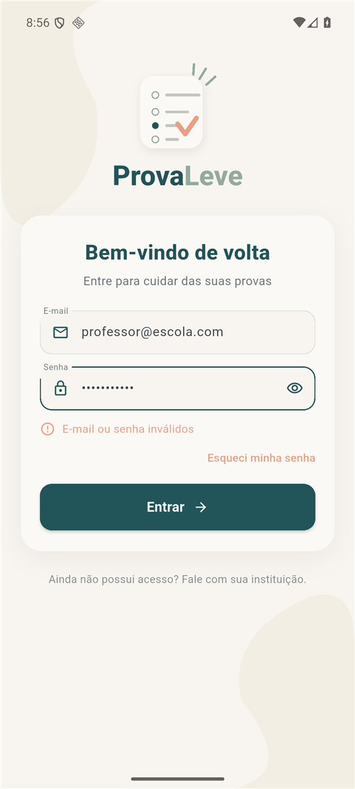

### CT02 – Login válido e Minhas Provas

Passos: entrar com `professor@escola.com` / `provaleve`.

Esperado: abrir Minhas Provas com as provas da professora gravadas no Firestore.

Obtido: a tela mostra "Carregando provas..." e em seguida a lista com as provas do banco, cada uma com a situação (Pronto, Corrigida).

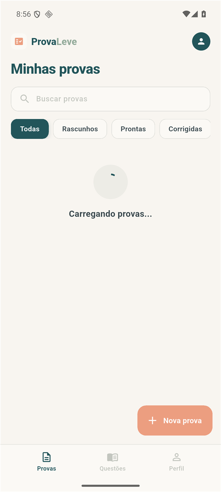 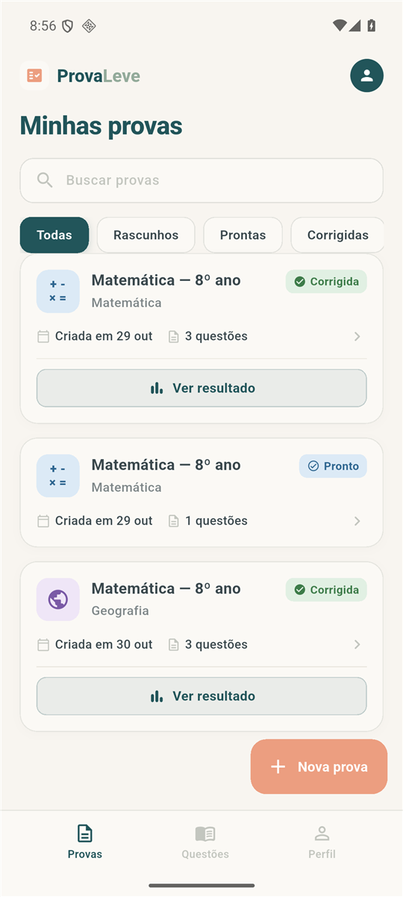

### CT03 – Banco de questões

Passos: abrir a aba Questões.

Esperado: listar as questões da professora gravadas no Firestore.

Obtido: 5 questões cadastradas, com disciplina, dificuldade e alternativa correta.

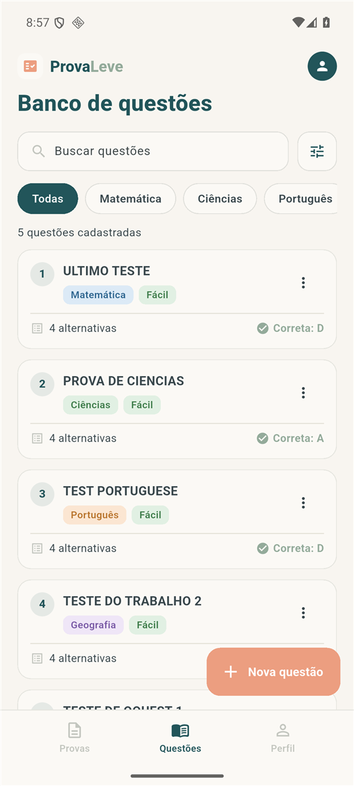

### CT04 – Cadastro de questão

Passos: tocar em "Nova questão" e em "Salvar questão" sem preencher nada; depois escolher Matemática, escrever o enunciado "Quanto vale 7 x 8 em uma multiplicacao simples", preencher as alternativas (54, 56, 64, 48, 72), marcar a B como correta e salvar. Por fim, buscar "quanto" no banco.

Esperado: o formulário vazio é recusado; a questão completa é gravada e aparece na busca.

Obtido: sem preencher, aparece "Selecione a disciplina da questão.". Com os dados completos aparece "Questão salva." e o total vai de 5 para 6 questões. A busca encontra a questão nova.

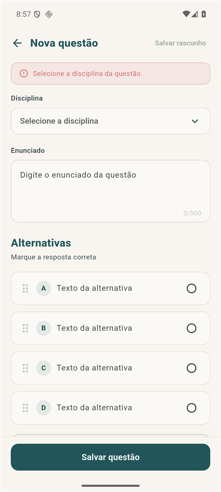 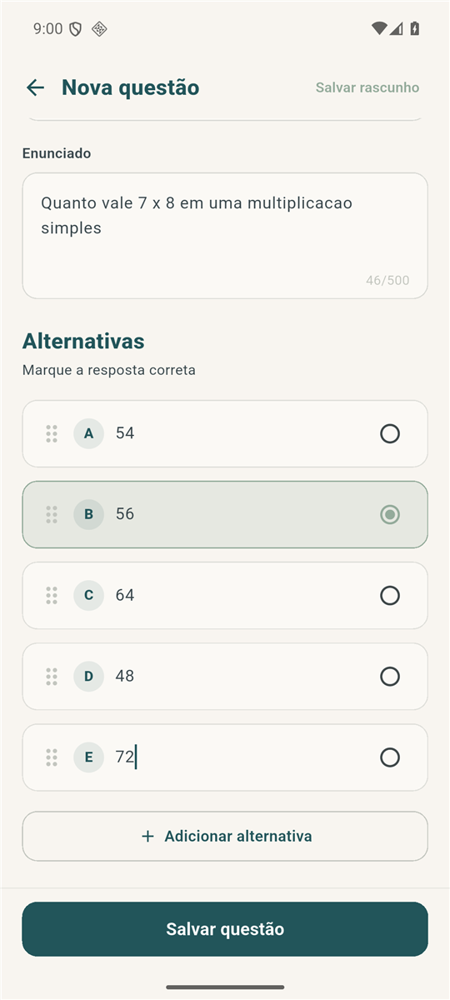 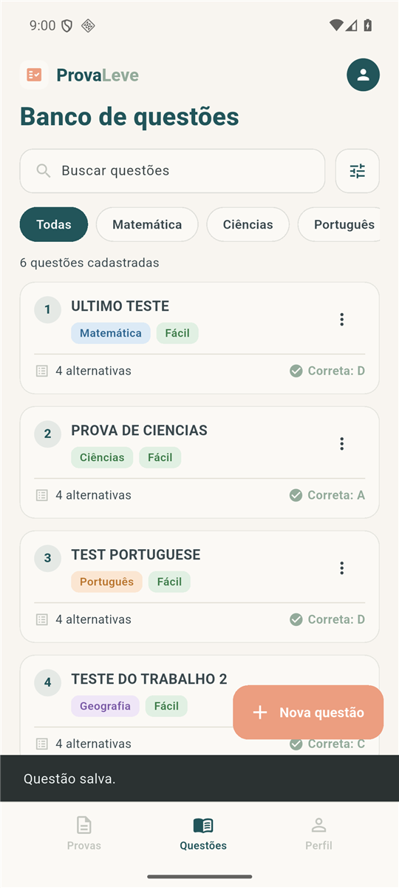 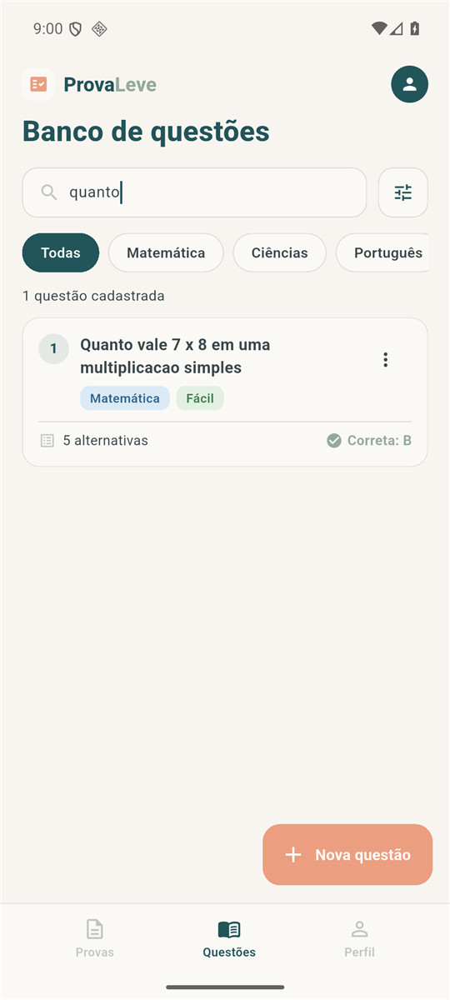

### CT05 – Criar e postar prova

Passos: em Minhas Provas, tocar em "Nova prova", dar o título "Prova de Multiplicacao", selecionar duas questões e tocar em "Postar".

Esperado: a prova é gravada com a situação Pronta.

Obtido: aparece "Prova postada com sucesso!" e a prova entra no topo da lista como "Pronto", com 2 questões.

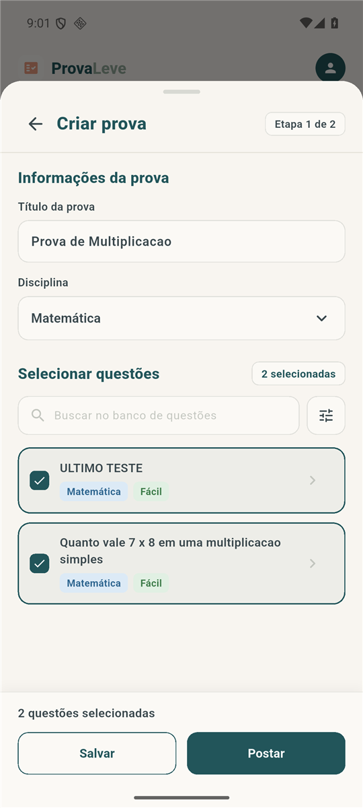 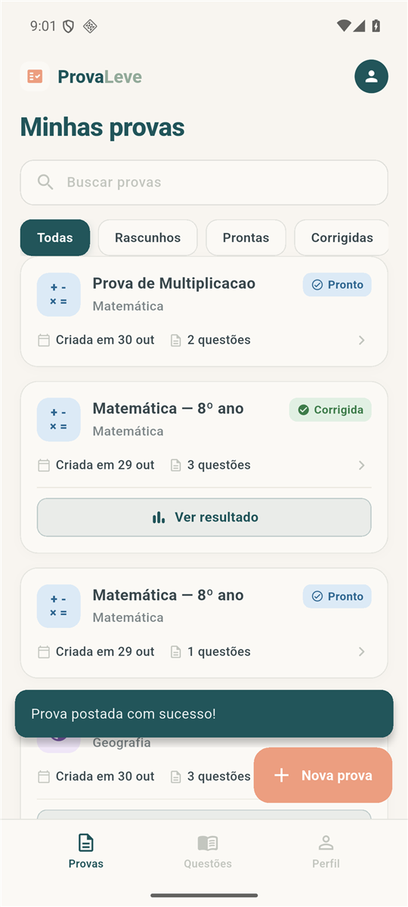

### CT06 – Correção e resultado

Passos: abrir a prova, tocar em "Corrigir prova", informar o aluno "Joao Pereira", marcar A na questão 1 (a correta é D) e B na questão 2 (correta) e tocar em "Corrigir e salvar".

Esperado: nota 5,0, com 1 acerto e 1 erro, mostrando a resposta do aluno e a correta.

Obtido: o resultado abre logo após o toque, em menos de 1 segundo (RNF05), com nota 5,0, 1 acerto e 1 erro. A questão errada aparece em vermelho com "Resposta do aluno: A / Correta: D" e a certa em verde (RNF07). A prova passa para a situação Corrigida.

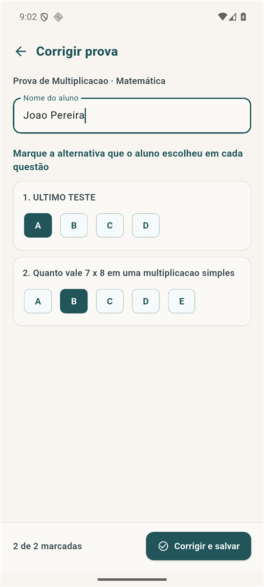 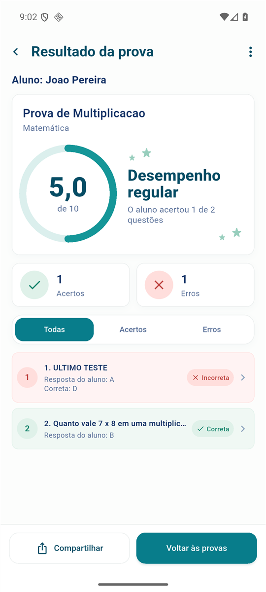

### CT07 – Lista de resultados e compartilhamento

Passos: no resultado, tocar em "Compartilhar"; depois voltar e tocar em "Ver resultado" na prova corrigida.

Esperado: abrir o compartilhamento do Android com o resultado; listar os alunos corrigidos da prova.

Obtido: a folha de compartilhamento do Android abre com o texto "Resultado da prova / Prova: Prova de Multiplicacao...", mas o print foi tirado antes de ela aparecer na tela. A lista mostra "Carregando resultados..." e depois Joao Pereira com 1 de 2 acertos, nota 5,0 e média da turma 5,0.

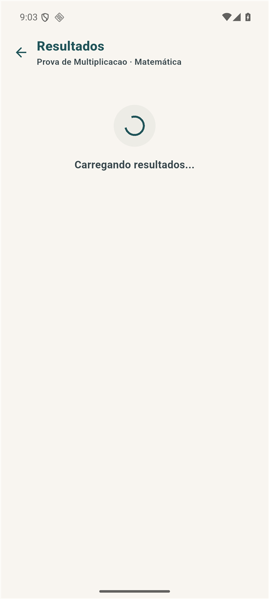 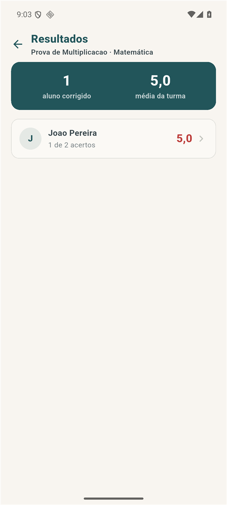

### CT08 – Editar e excluir questão

Passos: no banco, editar a questão do CT04 trocando a alternativa E de 72 para 63 e salvar; depois excluí-la, confirmando no aviso. Por fim, abrir a prova do CT05.

Esperado: a edição e a exclusão são gravadas no Firestore; a prova já montada não perde a questão, porque guarda uma cópia dela.

Obtido: aparecem "Questão atualizada." e, depois da confirmação, "Questão excluída.", e a busca fica sem resultados. A prova continua com 2 questões.

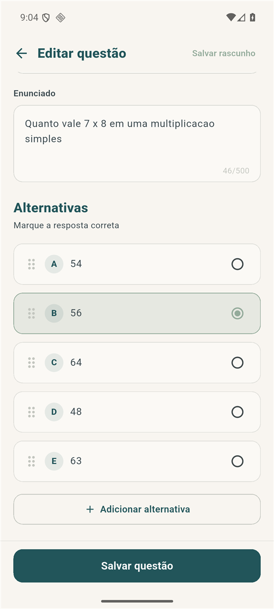 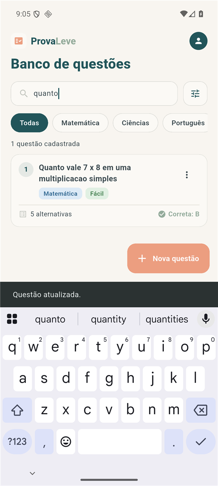 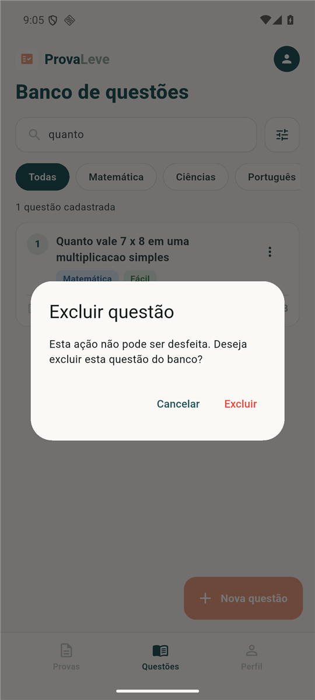 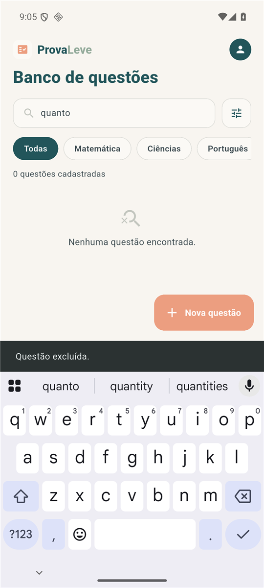 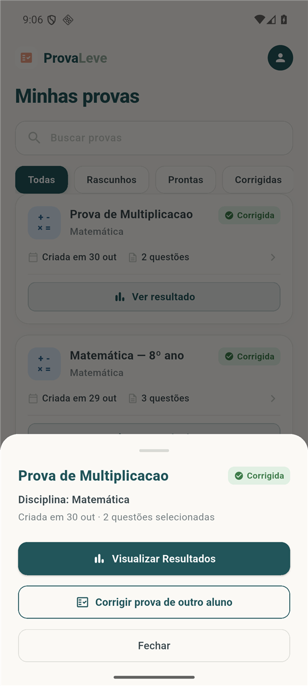

### CT09 – Dados de cada professor

Passos: sair da conta e entrar com `caua@provaleve.com` / `123456`; abrir Minhas Provas e o banco de questões.

Esperado: o professor vê apenas as próprias provas e questões.

Obtido: a lista mostra só as provas do Cauã, sem a "Prova de Multiplicacao". O banco de questões dele está vazio e mostra "Nenhuma questão cadastrada", enquanto o da Ana tem várias.

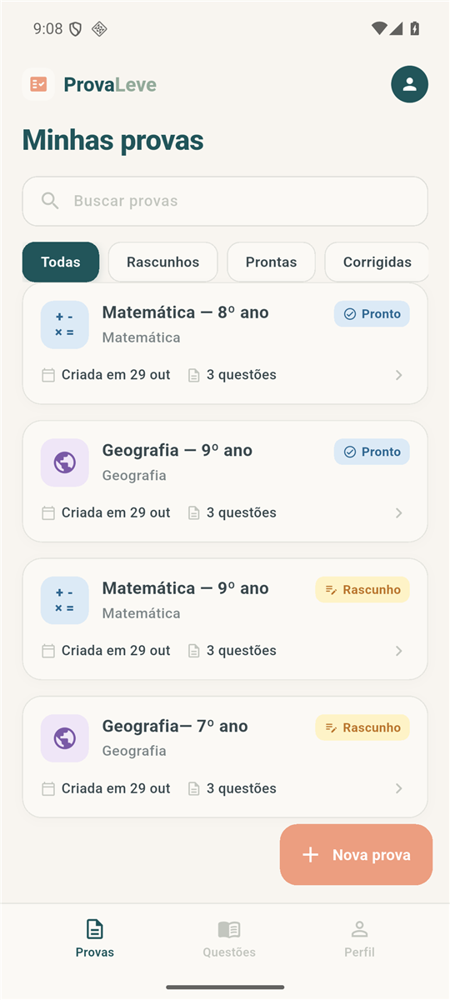 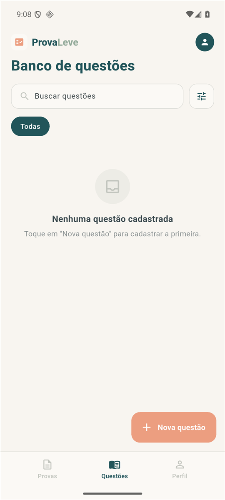

### CT10 – Sem internet

Passos: ligar o modo avião do emulador, sair e entrar com `mario@provaleve.com` / `123456` (professor que ainda não tinha dados no aparelho). Depois desligar o modo avião e tocar em "Tentar novamente".

Esperado: sem internet, mostrar uma mensagem clara com a opção de tentar de novo; com a conexão de volta, carregar normalmente.

Obtido: aparece "Não foi possível carregar / Sem conexão com a internet. Verifique a rede e tente novamente." com o botão "Tentar novamente". Com a conexão de volta, a tela carrega e mostra "Nenhuma prova criada", porque esse professor ainda não tem provas.

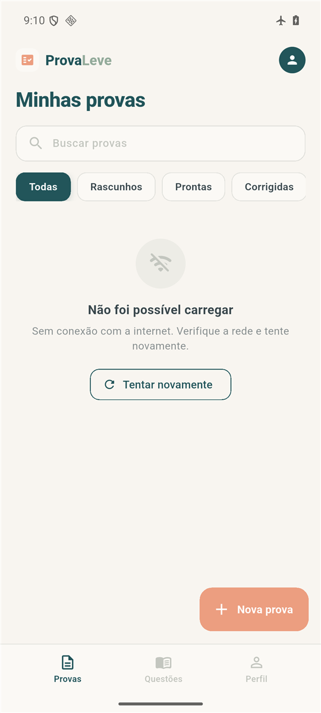 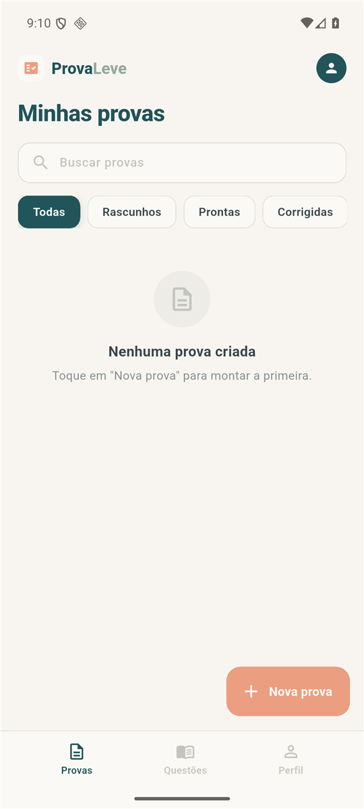

### CT11 – Dados vindos do servidor

Passos: apagar os dados do app no Android (o que limpa também o cache do Firestore), abrir o app e entrar de novo com `professor@escola.com`.

Esperado: as provas, incluindo a criada e corrigida nos casos anteriores, voltam do servidor.

Obtido: na primeira tentativa a leitura passou do limite de 15 segundos e a tela mostrou "A conexão está lenta. Verifique a internet e tente novamente.". Ao tocar em "Tentar novamente", as provas carregaram, incluindo a "Prova de Multiplicacao" como Corrigida.

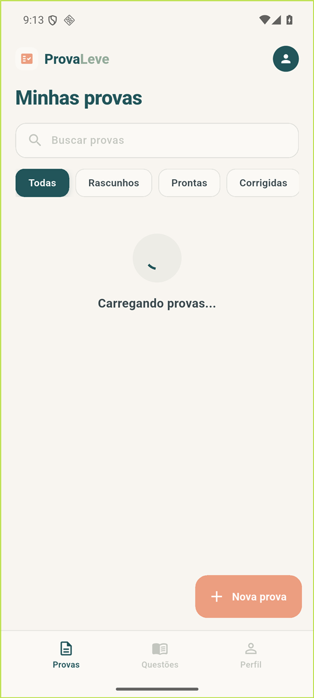 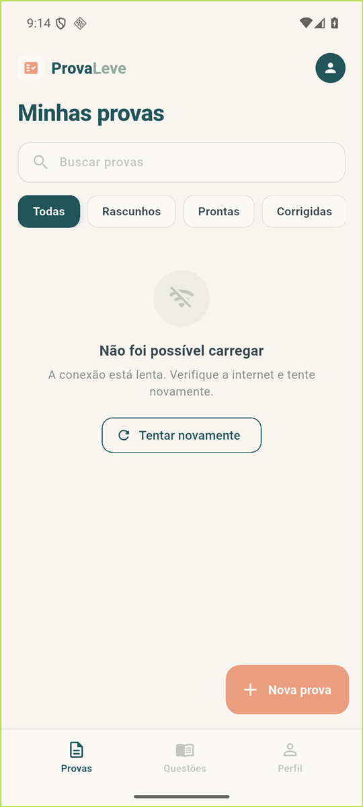 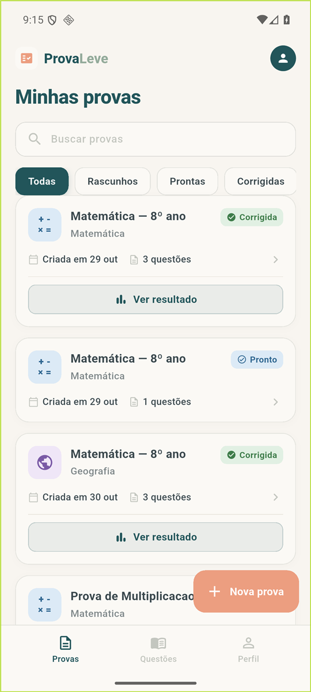

## Observações

* A demora do CT11 veio do emulador, que rodou com pouca memória livre no computador do teste. A mensagem de conexão lenta e o botão de tentar de novo funcionaram como esperado.
* Não foram testados nesta rodada: gravar sem internet e sincronizar depois, duplicar questão (RF13), salvar questão como rascunho (RF15) e recuperação de senha (RF02, que ainda é parcial).
* A prova "Prova de Multiplicacao" e o resultado do aluno Joao Pereira ficaram gravados na conta de teste `professor@escola.com`. A questão criada no CT04 foi excluída no CT08.
